# How Your Pricing Requests Travel Through the System
### A walkthrough for business users and technology partners

> **Placeholders to fill before publishing:** `[PLATFORM NAME]` · `[CLIENT NAME]` · auto job code lists (Appendix C) · open items (Appendix D)

---

## 📌 Contents

| Part | Topic | Best for |
|---|---|---|
| 0 | [How to Use This Guide](#part-0--how-to-use-this-guide) | Everyone |
| 1 | [The Big Picture in One Page](#part-1--the-big-picture-in-one-page) | Everyone |
| 2 | [What We Price](#part-2--what-we-price) | Everyone |
| 3 | [How Work Comes In](#part-3--how-work-comes-in) | Everyone |
| 4 | [The Job Table: The Waiting Room](#part-4--the-job-table-the-waiting-room) | Everyone |
| 5 | [The Two Engine Rooms: Airflow DAG 1 and Airflow DAG 2](#part-5--the-two-engine-rooms-airflow-dag-1-and-airflow-dag-2) | Everyone |
| 6 | [Side by Side vs. One at a Time](#part-6--side-by-side-vs-one-at-a-time) | ⭐ Everyone, the key idea |
| 7 | [Life of a Single Job](#part-7--life-of-a-single-job) | Everyone |
| 8 | [The Hidden Steps: Price Change and Aggregator](#part-8--the-hidden-steps-price-change-and-aggregator) | ⭐ Everyone |
| 9 | [Why Is My Job Waiting?](#part-9--why-is-my-job-waiting) | ⭐ Everyone |
| 10 | [Under the Hood: Components](#part-10--under-the-hood-components) | Technology audience |
| 11 | [Where We Are Heading: Classifiers](#part-11--where-we-are-heading-classifiers) | Everyone |
| 12 | [What We Are Improving for You](#part-12--what-we-are-improving-for-you) | Everyone |
| A–E | [Appendices](#appendix-a--glossary) | Reference |

---

## Part 0 · How to Use This Guide

After reading this guide you will be able to answer three questions on your own:

1. *Where is my job right now?*
2. *Why is it waiting?*
3. *Which things happen at the same time, and which happen one after another?*

The guide follows **one request** from the moment you click *Submit* to the moment prices land.

| If you want to know ... | Read |
|---|---|
| What we price and how a request travels, end to end | Parts 1–5 |
| What runs at the same time and what runs one after another | Part 6 |
| Why your job is waiting, or why the dashboard looks frozen | Parts 7–9 |
| What's changing: January state and beyond | Parts 11–12 |
| How the components fit together (technical) | Part 10 |

**How to read the diagrams:**

| Color | Meaning |
|---|---|
| 🟦 Blue | Securities and everything identified by CUSIP (Airflow DAG 1) |
| 🟩 Green | Loans (Airflow DAG 2) |
| 🟪 Purple | Stored data: the Job Table and the Price Change table |
| 🟨 Amber, dashed border | **Hidden steps** that are not shown on today's dashboard |
| 🩵 Teal | The Application User and the screens |
| 🟥 Red | Alarms and safety limits |
| 🟦 Indigo | Orchestration: Autosys + Airflow DAGs and tasks |
| ⬜ Grey | Work the system creates by itself (Auto Jobs, follow-up jobs) |
| 🩷 Rose | Results: prices saved and the dashboard |
| ⬜ White, dashed blue border | January state: the Securities Classifier |

---

## Part 1 · The Big Picture in One Page

### The story in six steps

```mermaid
flowchart LR
    S1["1. REQUEST<br/>Application User<br/>submits a job"] --> S2["2. WAIT<br/>Job lands in the<br/>Job Table"]
    S2 --> S3["3. PICK UP<br/>An Airflow DAG run scans<br/>and collects it"]
    S3 --> S4["4. PRICE<br/>A pricing engine<br/>works on it"]
    S4 --> S5["5. RIPPLE<br/>Changed prices trigger<br/>follow-up jobs"]
    S5 --> S6["6. DONE<br/>Prices saved,<br/>dashboard updated"]

    classDef user fill:#E0F7FA,stroke:#00838F,color:#00363A,stroke-width:2px
    classDef store fill:#EDE7F6,stroke:#5E35B1,color:#2A1458,stroke-width:2px
    classDef sec fill:#DCEBFF,stroke:#1F5FBF,color:#0B2545,stroke-width:2px
    classDef hidden fill:#FFF4D6,stroke:#C98A00,color:#5A3E00,stroke-width:2px,stroke-dasharray:5 5
    class S1 user
    class S2 store
    class S3,S4,S6 sec
    class S5 hidden
```

### 🎬 The complete journey, end to end

This picture is shown in **four connected pieces**. The rounded **"from" / "continues in"** markers show where each piece picks up.

| Piece | Covers |
|---|---|
| 1 | Application User → Job Table → the two engine rooms |
| 2 | Airflow DAG 1 · SecurityJobs · lanes 1.1 Opens and 1.2 Settles |
| 3 | Airflow DAG 1 · SecurityJobs · lane 1.3 run_ui_jobs → Price Change + Aggregator → back to the Job Table |
| 4 | Airflow DAG 2 · LoanJobs → prices saved → dashboard |

| Color | Group |
|---|---|
| 🩵 Teal | **Business:** what the Application User does |
| ⬜ Grey | **System-created work:** Auto Jobs and follow-up jobs |
| 🟪 Purple | **The queue:** the Job Table, and the job records a task collects from it |
| 🟥 Red | **A failed record.** The line keeps going. |
| 🟦 Indigo | **Orchestration:** Autosys + Airflow DAGs and tasks |
| 🟦 Blue | **Securities components:** microbatch engines and the products they price |
| 🟩 Green | **Loan components:** legacy batch engines, the Multi Family microbatch and their products |
| 🟨 Amber | **Ripple effect:** Price Change + Aggregator |
| ⬜ Dashed blue | **January state:** the Securities Classifier |
| 🩷 Rose | **Results:** prices saved and the dashboard |

> 🧭 **How to read every lane:** the **task** collects **all ready job records** that match its criteria. The records run **one after another**, and a failed record does **not** stop the ones behind it. When the engine picks up **one** record, it prices that record's **products in parallel** (for example MBS, AGENCY and MFMBS at the same time).

#### Piece 1 of 4 · From the Application User to the engine rooms

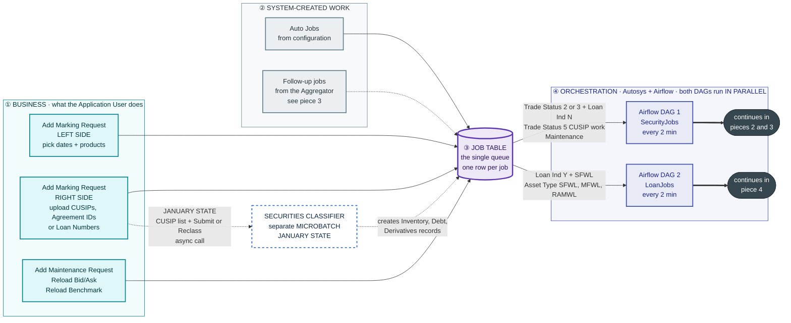

#### Piece 2 of 4 · Airflow DAG 1 · SecurityJobs: lanes 1.1 Opens and 1.2 Settles

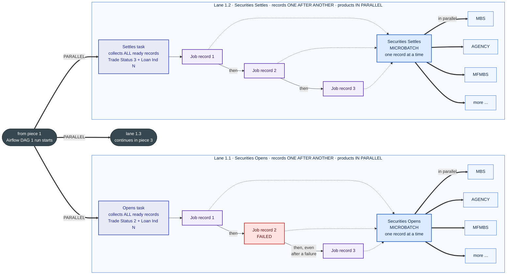

#### Piece 3 of 4 · Airflow DAG 1 · SecurityJobs: lane 1.3 run_ui_jobs and the ripple back to the Job Table

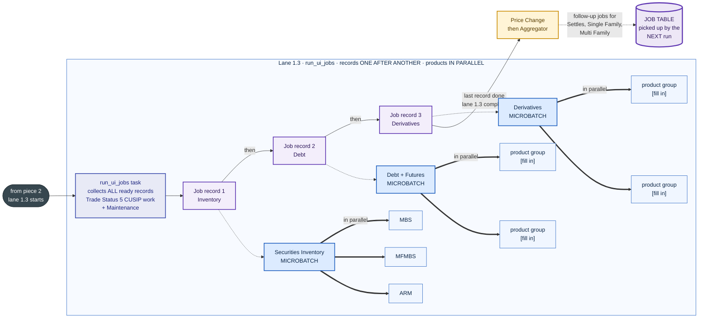

> 🔁 **Run rule:** Airflow DAG 1's run ends only when **lanes 1.1, 1.2 and 1.3 and the Aggregator** have all finished. Only then can the next 2-minute tick start a new run. That run collects the new ready records, including the follow-up jobs the Aggregator just added.

> 📅 **January state for pieces 2 and 3:** lane 1.3 (run_ui_jobs) splits into **three separate parallel lanes**: Security Inventory, Debt and Derivatives. Price Change + Aggregator then follow the **Security Inventory** lane. See [Part 5 · January state](#part-5--the-two-engine-rooms-airflow-dag-1-and-airflow-dag-2).

#### Piece 4 of 4 · Airflow DAG 2 · LoanJobs: loans, then results to the dashboard

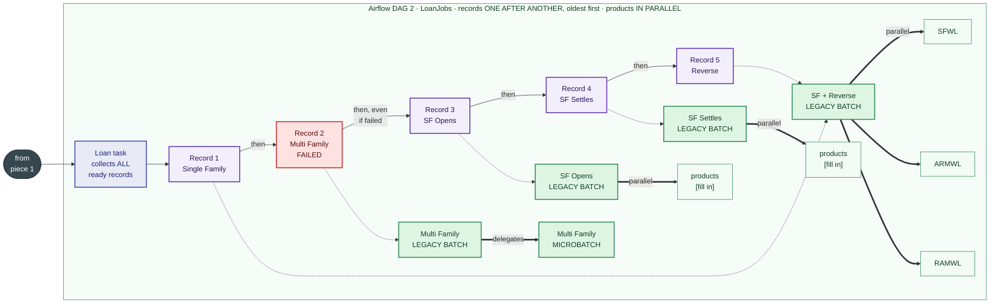

**…and the results, for both engine rooms**

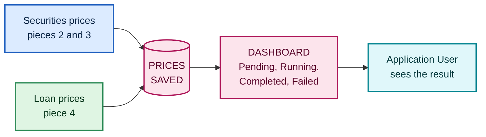

#### What runs in parallel, and what runs in sequence, across the journey

| Where | Parallel or sequential? |
|---|---|
| Airflow DAG 1 vs. Airflow DAG 2 | 🔀 **Parallel.** They never wait for each other. |
| Lanes 1.1, 1.2 and 1.3 inside Airflow DAG 1 | 🔀 **Parallel.** All three start together. |
| Job records collected by one task | ➡️ **Sequential.** One record after another. **A failure does not stop the line.** |
| Products inside one job record (MBS, ARM, AGENCY …) | 🔀 **Parallel**, inside the engine that picked up the record. |
| Price Change and Aggregator | ➡️ **Sequential.** They start only after lane 1.3 finishes its last record. |
| Loan job records in Airflow DAG 2 | ➡️ **Sequential.** One at a time, oldest first, even after a failure. |
| One run vs. the next run of the same Airflow DAG | ➡️ **Sequential.** The next run waits for the current one to finish. |
| Follow-up jobs from the Aggregator | ➡️ **Next run.** They go back into the Job Table and are collected like any other job. |

### ⭐ The five things to remember

| # | Takeaway |
|---|---|
| 1 | **Every request becomes a row in one Job Table.** Screens, uploads, auto jobs and maintenance all go there. |
| 2 | **Two engine rooms work at the same time:** Airflow DAG 1 handles securities and everything identified by CUSIP, and Airflow DAG 2 handles loans. |
| 3 | **Lanes run side by side. Job records inside a lane go one after another, even if one fails. Inside each record, the products (MBS, ARM, AGENCY …) are priced in parallel.** |
| 4 | **A run must fully finish before the next run starts.** That includes the hidden Price Change and Aggregator steps. |
| 5 | **A job submitted after a run has started waits for the next run.** |

> 💡 **In plain words:** think of a restaurant with two kitchens. Every two minutes, the head chef collects every order ticket on the rail. Each station cooks its tickets one at a time, and the stations cook at the same time. Tickets that arrive after the chef collected them wait for the next round, and the next round only starts once the whole kitchen has finished the current one, including the tasting at the end.

---

## Part 2 · What We Price

Everything we price falls into one of two families, depending on **how it is identified**.

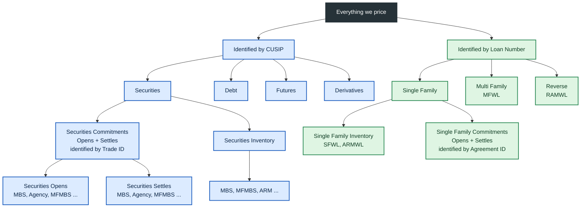

### Identifiers at a glance

| Family | What it is | Identified by |
|---|---|---|
| Securities Opens / Settles | Securities commitments | **Trade ID** |
| Securities Inventory, Debt, Futures, Derivatives | Held positions | **CUSIP** |
| Single Family Opens / Settles | Loan commitments (also called "SF Opens") | **Agreement ID** |
| Single Family, Multi Family, Reverse Inventory | Held loans | **Loan Number** |

> 💡 **Vocabulary:** "Commitments" is the umbrella word for **Opens + Settles**, for securities and for Single Family alike.

---

## Part 3 · How Work Comes In

There are **four doors** into the system, and all of them lead to the same Job Table.

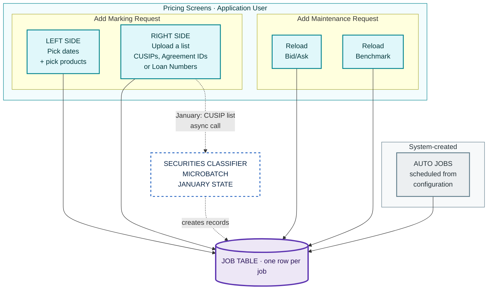

| Door | Who starts it | What it does |
|---|---|---|
| **Marking, left side** | Application User | Prices products the user selects for chosen dates |
| **Marking, right side** | Application User | Prices exactly the IDs in an uploaded list |
| **Maintenance** | Application User | Reloads Bid/Ask or Benchmark data the pricing relies on |
| **Auto Jobs** | The system | Recurring jobs set up from configuration (codes in Appendix C) |

> 📅 **January state:** a right-side **CUSIP** upload with **Submit** or **Reclass** triggers an asynchronous call to the **Securities Classifier** microbatch. The classifier then creates the Inventory, Debt + Futures and Derivatives records. See Part 11.

### The three request types

| Code | Name | Plain meaning |
|---|---|---|
| **1** | **Submit** | "Price this for the first time." |
| **2** | **Rerun** | "Price this again, the same way as before." |
| **3** | **Reclass** | "Forget what you knew about this, re-classify it, and price it fresh." The old record is deleted and a new one is created. |

> 💡 **In plain words:** whichever button you press, the result is the same: one or more rows join the queue in the Job Table. Nothing gets priced at the moment you click. It gets priced when an engine room collects it.

---

## Part 4 · The Job Table: The Waiting Room

The Job Table is the **single queue** for all work. Each lane recognises **its own rows** using a combination of fields, like a mail sorter reading a postcode.

### The fields that decide where a job goes

| Field | Values | Meaning |
|---|---|---|
| **Effective Date** | a date | The pricing date |
| **Job Request Type** | 1 Submit · 2 Rerun · 3 Reclass | What kind of request |
| **Trade Status** | **2** Opens · **3** Settles · **5** Inventory | Which stage of life the position is in |
| **Loan Ind** | **Y** or **N** | Loan or security. *Filled only for Opens/Settles (commitments).* |
| **Asset Type** | Securities: MBS, MFMBS, ARM ... · Loans: SFWL, MFWL, RAMWL | The product family |
| **Job Type** | UI job or Auto Job code (e.g. `21 AUTO_RELEVEL`) | What triggered it |
| **Status** | Pending · Running · Completed · Failed | Where it is in its life |

### How each row finds its lane

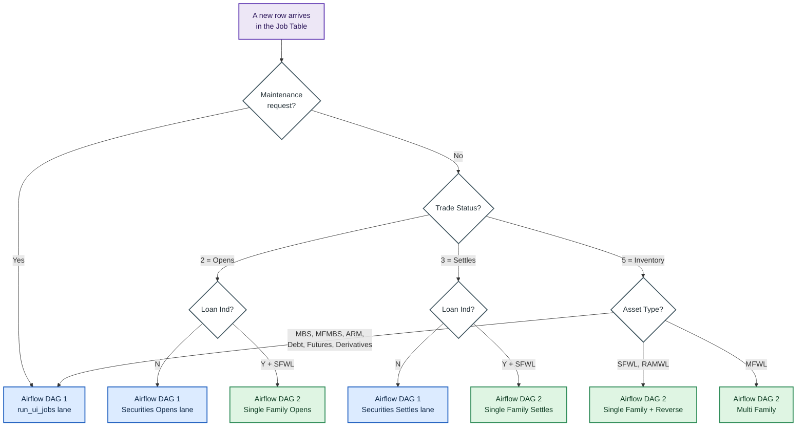

> 💡 **Why Loan Ind alone isn't enough:** Loan Ind is filled only for commitments (Opens/Settles). For inventory, the **Asset Type** tells us whether a row is a security or a loan, and which kind of loan.

The full field-by-field reference for each lane is in **[Appendix B](#appendix-b--job-routing-key-reference)**.

---

## Part 5 · The Two Engine Rooms: Airflow DAG 1 and Airflow DAG 2

An **Airflow DAG** is simply a scheduled checklist of steps. Airflow, triggered through Autosys, runs two of them, **SecurityJobs** and **LoanJobs**, and they **never wait for each other**.

| | Airflow DAG 1 · **SecurityJobs** | Airflow DAG 2 · **LoanJobs** |
|---|---|---|
| Handles | Securities Opens, Settles, Inventory, Debt, Futures, Derivatives, Maintenance | Single Family, Multi Family, Reverse, SF Opens, SF Settles |
| Starts | Every 2 minutes, **if the previous run has finished** | Every 2 minutes, **if the previous run has finished** |
| Lanes inside | 3 lanes side by side, then 2 follow-up steps · **January state: 5 lanes** | 1 lane |
| Order inside a lane | One job after another | One job after another, **oldest first** (by insertion date) |

### Airflow DAG 1 · SecurityJobs: securities and all CUSIP work

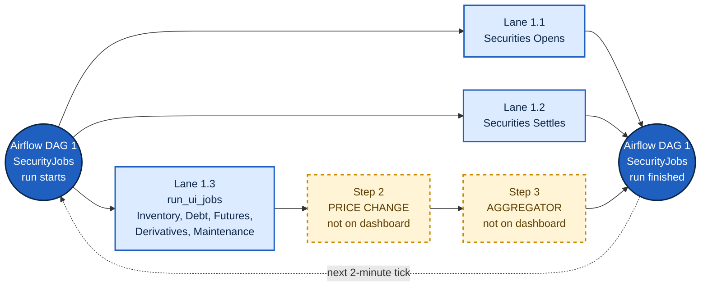

**Reading the picture:**
- Lanes **1.1, 1.2 and 1.3 start at the same moment.**
- **Price Change waits only for lane 1.3** (run_ui_jobs), because it needs the new inventory prices. Opens and Settles do not feed it.
- The run is **finished only when every path reaches the end**, including Price Change and Aggregator.

### 📅 Airflow DAG 1 · SecurityJobs · January state: five tasks in parallel

From January, today's single **run_ui_jobs** task is **split into three separate tasks**: Security Inventory, Debt and Derivatives. Together with Opens and Settles, Airflow DAG 1 then starts **five tasks at the same time**. Price Change and Aggregator still run one after the other, and only after the **Security Inventory** task.

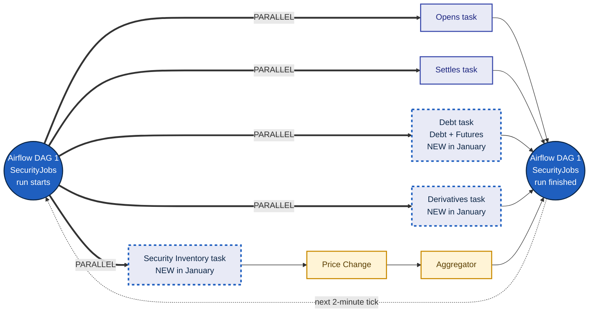

| | Today | January state |
|---|---|---|
| Tasks in Airflow DAG 1 | 3: Opens, Settles, run_ui_jobs | **5:** Opens, Settles, Security Inventory, Debt, Derivatives |
| Debt and Derivatives jobs | Wait in the **same line** as Inventory and Maintenance | Each has **its own line** and starts at the same time as the others |
| Price Change + Aggregator | After run_ui_jobs | After the **Security Inventory** task |
| Next Airflow DAG 1 run starts | When all tasks + Aggregator finish | **Unchanged:** when all five tasks + Aggregator finish |

> 💡 **In plain words:** in January, the one busy counter that served Inventory, Debt and Derivatives becomes three counters. Debt and Derivatives jobs stop queuing behind Inventory.

### Airflow DAG 2 · LoanJobs: loans

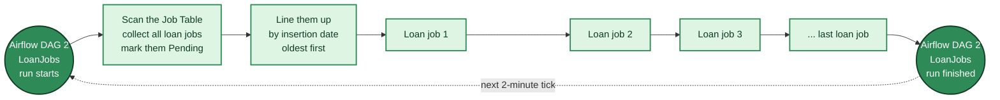

> 💡 **In plain words:** loans form one single line, like a bank with one teller. Whoever arrived first is served first, whether it's a Single Family job, a Multi Family job or a follow-up the system created.

---

## Part 6 · Side by Side vs. One at a Time

⭐ **This is the key idea of the guide.** "Parallel" means different things at different levels.

### The three levels

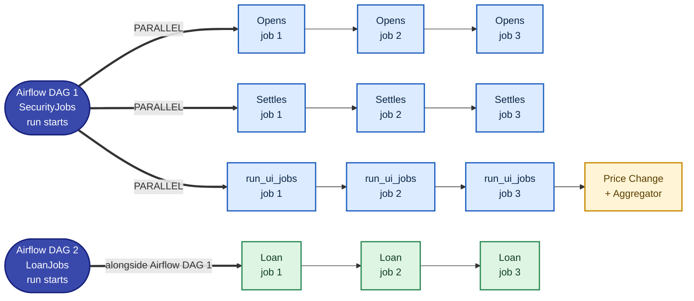

> 👀 **How to read it:** **read across** a row and things happen **one after another**. **Read down** the rows and they happen **at the same time**. Inside each job, the engine prices the products (MBS, ARM, AGENCY …) in parallel.

| Level | What runs together? | What waits? |
|---|---|---|
| **1. Airflow DAGs** | Airflow DAG 1 and Airflow DAG 2 run at the same time | Nothing; they are independent |
| **2. Lanes inside Airflow DAG 1** | Opens, Settles and run_ui_jobs start together · **January state:** Opens, Settles, Security Inventory, Debt, Derivatives | Price Change waits for run_ui_jobs (January state: for Security Inventory), and Aggregator waits for Price Change |
| **3. Job records inside a lane** | **Nothing**: one record at a time | Every record waits for the one ahead of it. A failure does not stop the line. |
| **4. Products inside one record** | MBS, ARM, AGENCY … are priced **together** by the engine | Nothing; this is the engine's own parallel work |

### The same thing as a conversation

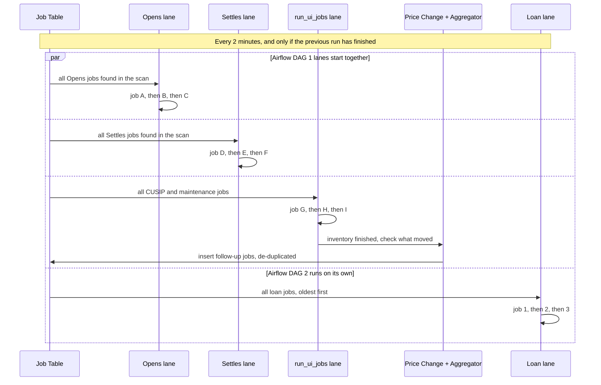

### 📅 January state: five lanes instead of three

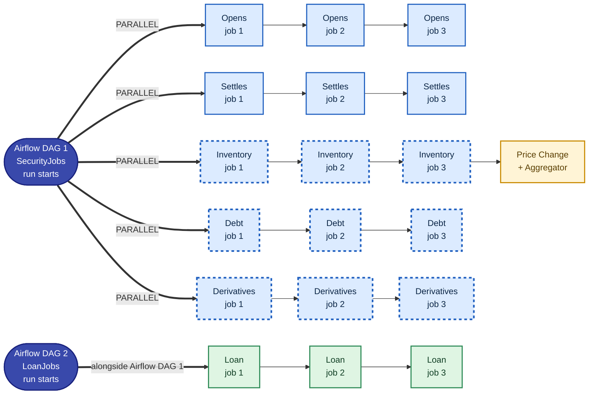

> The **dashed rows** are new in January. Inventory, Debt and Derivatives each get their own row, so they run **side by side** instead of sharing one line. Inside every row, jobs still go one after another, which the future state below addresses.

### Quick answers to the usual confusion

| Question | Answer |
|---|---|
| Do Airflow DAG 1 and Airflow DAG 2 run at the same time? | ✅ **Yes** |
| Do Opens, Settles and run_ui_jobs start at the same time? | ✅ **Yes** |
| If there are 3 Opens jobs, do they run at the same time? | ❌ **No.** One after another. |
| If job record 2 fails, does job record 3 still run? | ✅ **Yes.** The line keeps going. |
| Inside one job, are MBS, ARM and AGENCY priced one by one? | ❌ **No.** The engine prices them **in parallel**. |
| Do loan jobs run at the same time? | ❌ **No.** One at a time, oldest first. |
| Does Price Change start with the other lanes? | ❌ **No.** It waits for run_ui_jobs. |
| Can a new Airflow DAG 1 run start while Price Change is still going? | ❌ **No.** The whole run must finish first. |
| Do my Opens jobs depend on Inventory prices? | **Not for data.** But a *new* Opens job still waits for the whole Airflow DAG 1 run to end, because the next run cannot start until then. |

> 🧠 **The three rules**
> 1. **Lanes run side by side. Records inside a lane go one at a time, and the products inside each record are priced in parallel.**
> 2. **A run must fully finish before the next run begins, including the steps you can't see.**
> 3. **If you submit after a run has collected its jobs, you wait for the next run.**

### 🔮 Future state (proposed): ready records in parallel

Today, each lane works through its ready records **one after another**. A possible next step is to let a lane run its ready records **at the same time**, so one large job no longer holds up the small jobs behind it.

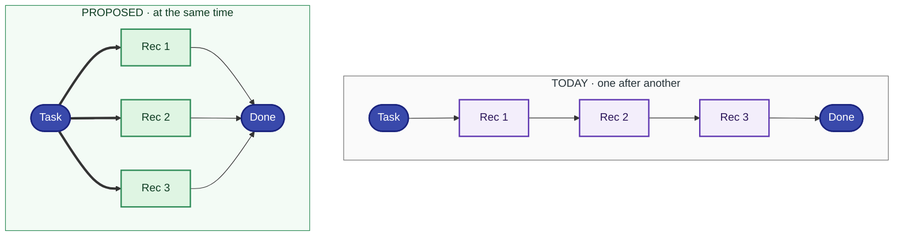

| | Today | Proposed |
|---|---|---|
| Records in a lane | One after another | At the same time, up to a set limit |
| A big upload ahead of you | You wait for it to finish | You run alongside it |
| Lane finishes when | The last record finishes | The slowest record finishes |
| Price Change and Aggregator | After lane 1.3 | Still after lane 1.3; unchanged |

**Things to design before switching:**
- **A cap on how many records run at once**, so the engines and the database are not overloaded.
- **The same CUSIP or loan in two ready records:** these must not be priced at the same moment.
- **Loans today rely on oldest-first order.** Any record that depends on an earlier one must still wait for it.

> 💡 **In plain words:** today each lane is a single checkout line. The future idea is to open more checkouts in the same lane, with rules so that two people never buy the same item at once.

---

## Part 7 · Life of a Single Job

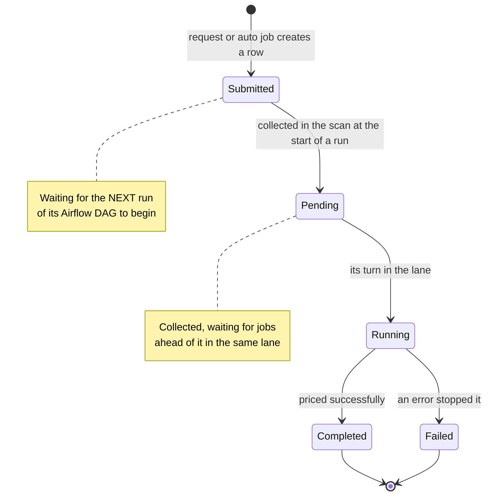

| Status | Where the job is | Usually waiting on |
|---|---|---|
| **Submitted** *(name to confirm, see Appendix D)* | In the Job Table, not yet collected | The **current run of its Airflow DAG** to finish |
| **Pending** | Collected by a run, in line | **Jobs ahead of it** in its lane |
| **Running** | Being priced now | Its own size, such as the length of the uploaded list |
| **Completed** | Done | — |
| **Failed** | Stopped with an error | User action: review, then **Rerun (type 2)** |

> 💡 **How collection works:** at the **first scan** of a run, the lane collects **all** of its eligible rows at once and marks them Pending. It then works through them one by one. Rows that arrive after that scan wait for the next run.

---

## Part 8 · The Hidden Steps: Price Change and Aggregator

### Why prices ripple: parents and children

Some prices are **built on top of other prices**. For example, the precise price of certain Multi Family loans is their **parent security's price**. So when a parent's price moves, every child that used it must be **priced again**.

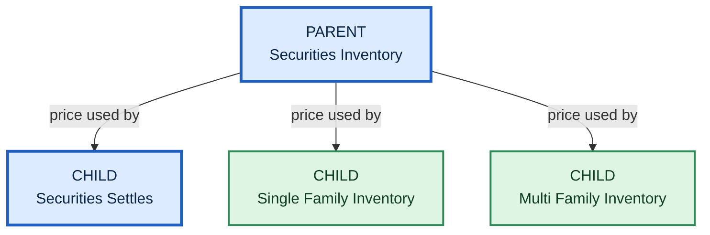

### What Price Change and Aggregator do

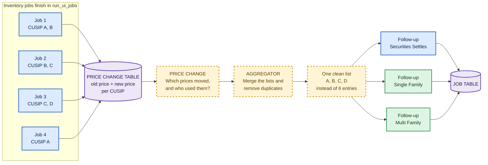

| Step | What it does | Why it matters |
|---|---|---|
| **Inventory jobs** | Reprice securities and record old and new price in the Price Change table | Creates the "what moved" record |
| **Price Change** | Finds which changed prices were being used by children | Only children that relied on the parent get repriced |
| **Aggregator** | Merges overlapping lists so each CUSIP is handled once | Avoids **duplicate reruns** of the same CUSIP |
| **Follow-up jobs** | New auto jobs inserted into the Job Table | Picked up by the **next** run: Settles by Airflow DAG 1, Single and Multi Family by Airflow DAG 2 (at the back of the loan line) |

### Safety limits on Price Change

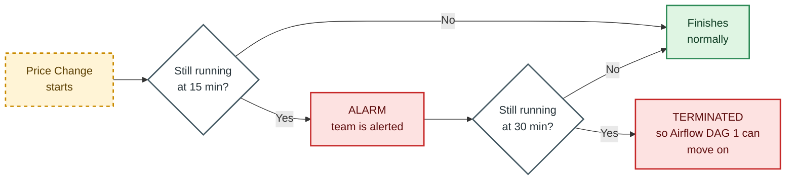

### ⭐ What you see vs. what is happening

This table explains why the dashboard can look frozen.

| Moment in an Airflow DAG 1 run | Behind the scenes | What the dashboard shows |
|---|---|---|
| Run starts | Lanes scan and collect jobs | Jobs move to **Pending** |
| Lanes working | Jobs priced one by one | **Running → Completed**, one at a time |
| Inventory finished | **Price Change** is comparing prices | 🟨 **Nothing changes. Looks frozen.** |
| Price Change finished | **Aggregator** merges lists and inserts follow-ups | 🟨 **Nothing changes. Looks frozen.** |
| Run ends, next tick | New run scans the Job Table | New jobs, including yours, move to **Pending** |

> 💡 **In plain words:** when the dashboard seems stuck, the system is usually not idle. It is checking which prices moved and making sure every dependent price is refreshed. Today you just can't see that step, and Part 12 covers how we plan to show it.

---

## Part 9 · Why Is My Job Waiting?

### A typical "stuck" moment, step by step

```mermaid
sequenceDiagram
    participant U as Application User
    participant JT as Job Table
    participant D1 as Airflow DAG 1 run
    participant HS as Price Change + Aggregator
    participant DB as Dashboard

    D1->>JT: scan done, jobs collected, lanes busy
    U->>JT: submits a new job
    Note over JT: Job is Submitted, but this run already collected its jobs
    D1->>HS: inventory done, hidden steps begin
    Note over HS,DB: Dashboard shows no movement during this time
    HS->>JT: follow-up jobs inserted
    HS-->>D1: run complete
    Note over D1: next 2-minute tick
    D1->>JT: new run scans and collects the user's job
    JT->>DB: Pending, then Running, then Completed
```

### Self-check guide

```mermaid
flowchart TD
    A["My job is not moving"] --> B{"What status<br/>does it show?"}

    B -->|"Not collected yet"| C["Your job arrived after the scan.<br/>It will be collected when the<br/>CURRENT run fully finishes,<br/>including Price Change<br/>and Aggregator."]
    B -->|"Pending"| D{"Securities<br/>or Loan?"}
    B -->|"Running"| E["It is being priced now.<br/>Bigger lists take longer."]
    B -->|"Failed"| F["Review the error,<br/>then Rerun with type 2<br/>or contact support."]

    D -->|"Securities"| D1["Jobs ahead of you in the<br/>SAME lane are running<br/>one at a time."]
    D -->|"Loan"| D2["Loans are served strictly<br/>oldest first. Earlier uploads<br/>and follow-up jobs go first."]

    classDef user fill:#E0F7FA,stroke:#00838F,color:#00363A,stroke-width:2px
    classDef decide fill:#FFFFFF,stroke:#455A64,color:#263238,stroke-width:2px
    classDef hidden fill:#FFF4D6,stroke:#C98A00,color:#5A3E00,stroke-width:2px
    classDef sec fill:#DCEBFF,stroke:#1F5FBF,color:#0B2545,stroke-width:2px
    classDef loan fill:#DFF5E3,stroke:#2E8B57,color:#0F3D23,stroke-width:2px
    classDef alert fill:#FDE2E1,stroke:#C62828,color:#5C0B0B,stroke-width:2px
    class A user
    class B,D decide
    class C hidden
    class D1,E sec
    class D2 loan
    class F alert
```

### The most common reasons for waiting

| # | Reason | Applies to | What it feels like |
|---|---|---|---|
| 1 | Submitted **after** the current run collected its jobs | Everyone | "It isn't even Pending yet." |
| 2 | Current Airflow DAG 1 run is in **Price Change or Aggregator** (up to a 30-minute limit) | Securities | "The whole dashboard froze." |
| 3 | **Earlier jobs in the same lane** are still running | Everyone | "Pending forever." |
| 4 | A **large upload** ahead of you in the same lane | Everyone | "Someone else's job is blocking mine." |
| 5 | **Follow-up jobs** from Aggregator joined the line | Settles, Single and Multi Family | "Jobs I didn't submit are ahead of me." |
| 6 | **Maintenance jobs** (Reload Bid/Ask, Benchmark) share the run_ui_jobs lane | Inventory, Debt, Futures, Derivatives | "My inventory job waited behind a reload." |

---

## Part 10 · Under the Hood: Components

*For the technology audience. Business users can skip this part.*

### Securities side (Airflow DAG 1)

```mermaid
flowchart TB
    JT[("JOB TABLE")]

    subgraph D1["Airflow DAG 1 · SecurityJobs · every 2 min · the three tasks run IN PARALLEL"]
        T1["Opens task<br/>Trade Status 2<br/>Loan Ind N"]
        T2["Settles task<br/>Trade Status 3<br/>Loan Ind N"]
        T3["run_ui_jobs task<br/>Trade Status 5 CUSIP work<br/>+ Maintenance"]
    end

    subgraph ENG["Pricing engines · MICROBATCH · each works its jobs ONE AT A TIME"]
        E1["Securities<br/>Opens"]
        E2["Securities<br/>Settles"]
        E3["Securities<br/>Inventory"]
        E4["Debt +<br/>Futures"]
        E5["Derivatives"]
    end

    PC["Price Change"] --> AG["Aggregator"]
    UIC["Pricing UI<br/>CUSIP upload<br/>Submit or Reclass"] -.->|"JANUARY STATE<br/>async call"| SC["SECURITIES CLASSIFIER<br/>MICROBATCH<br/>not an Airflow DAG task"]
    SC -.->|"creates records"| JT

    JT --> T1
    JT --> T2
    JT --> T3
    T1 --> E1
    T2 --> E2
    T3 --> E3
    T3 --> E4
    T3 --> E5
    E3 -->|"after run_ui_jobs finishes"| PC
    AG -.->|"follow-up jobs"| JT

    classDef store fill:#EDE7F6,stroke:#5E35B1,color:#2A1458,stroke-width:3px
    classDef orch fill:#E8EAF6,stroke:#3949AB,color:#1A237E,stroke-width:2px
    classDef sec fill:#DCEBFF,stroke:#1F5FBF,color:#0B2545,stroke-width:2px
    classDef hidden fill:#FFF4D6,stroke:#C98A00,color:#5A3E00,stroke-width:2px,stroke-dasharray:5 5
    class JT store
    class T1,T2,T3 orch
    class E1,E2,E3,E4,E5 sec
    class PC,AG hidden
    classDef user fill:#E0F7FA,stroke:#00838F,color:#00363A,stroke-width:2px
    classDef jan fill:#FFFFFF,stroke:#1F5FBF,color:#0B2545,stroke-width:2px,stroke-dasharray:5 5
    class UIC user
    class SC jan
    style D1 fill:#F5F6FC,stroke:#3949AB,color:#1A237E
    style ENG fill:#F4F8FF,stroke:#1F5FBF,color:#0B2545
```

### 📅 Securities side · January state

```mermaid
flowchart TB
    UIC["Pricing UI<br/>CUSIP upload<br/>Submit or Reclass"] -.->|"async call"| SC["SECURITIES CLASSIFIER<br/>MICROBATCH<br/>not an Airflow DAG task"]
    SC -.->|"creates Inventory, Debt,<br/>Derivatives records"| JT[("JOB TABLE")]

    subgraph D1J["Airflow DAG 1 · SecurityJobs · January state · five tasks run IN PARALLEL"]
        T1["Opens task"]
        T2["Settles task"]
        T3["Security Inventory<br/>task"]
        T4["Debt task"]
        T5["Derivatives task"]
    end

    subgraph ENGJ["Pricing engines · MICROBATCH · one record at a time, products in parallel"]
        E1["Securities<br/>Opens"]
        E2["Securities<br/>Settles"]
        E3["Securities<br/>Inventory"]
        E4["Debt +<br/>Futures"]
        E5["Derivatives"]
    end

    PC["Price Change"] --> AG["Aggregator"]

    JT --> T1
    JT --> T2
    JT --> T3
    JT --> T4
    JT --> T5
    T1 --> E1
    T2 --> E2
    T3 --> E3
    T4 --> E4
    T5 --> E5
    E3 -->|"after Security Inventory<br/>task finishes"| PC
    AG -.->|"follow-up jobs"| JT

    classDef store fill:#EDE7F6,stroke:#5E35B1,color:#2A1458,stroke-width:3px
    classDef orch fill:#E8EAF6,stroke:#3949AB,color:#1A237E,stroke-width:2px
    classDef jan fill:#E8EAF6,stroke:#1F5FBF,color:#0B2545,stroke-width:3px,stroke-dasharray:5 5
    classDef cls fill:#FFFFFF,stroke:#1F5FBF,color:#0B2545,stroke-width:2px,stroke-dasharray:5 5
    classDef sec fill:#DCEBFF,stroke:#1F5FBF,color:#0B2545,stroke-width:2px
    classDef hidden fill:#FFF4D6,stroke:#C98A00,color:#5A3E00,stroke-width:2px
    classDef user fill:#E0F7FA,stroke:#00838F,color:#00363A,stroke-width:2px
    class JT store
    class T1,T2 orch
    class T3,T4,T5 jan
    class SC cls
    class UIC user
    class E1,E2,E3,E4,E5 sec
    class PC,AG hidden
    style D1J fill:#F5F6FC,stroke:#3949AB,color:#1A237E
    style ENGJ fill:#F4F8FF,stroke:#1F5FBF,color:#0B2545
```

### Loan side (Airflow DAG 2)

```mermaid
flowchart TB
    JT[("JOB TABLE")]
    JT -->|"all loan rows, oldest first"| T4["Loan task · Airflow DAG 2 · LoanJobs · every 2 min<br/>ALL loan jobs ONE AT A TIME"]

    subgraph LEG["Pricing engines · LEGACY BATCH"]
        L1["Single Family<br/>+ Reverse<br/>Trade Status 5<br/>SFWL, RAMWL"]
        L2["Multi Family<br/>Trade Status 5<br/>MFWL"]
        L3["Single Family<br/>Opens<br/>Trade Status 2<br/>SFWL + Loan Ind Y"]
        L4["Single Family<br/>Settles<br/>Trade Status 3<br/>SFWL + Loan Ind Y"]
    end
    L2M["Multi Family<br/>MICROBATCH"]

    T4 --> L1
    T4 --> L2
    T4 --> L3
    T4 --> L4
    L2 -->|"delegates work"| L2M

    classDef store fill:#EDE7F6,stroke:#5E35B1,color:#2A1458,stroke-width:3px
    classDef orch fill:#E8EAF6,stroke:#3949AB,color:#1A237E,stroke-width:2px
    classDef loan fill:#DFF5E3,stroke:#2E8B57,color:#0F3D23,stroke-width:2px
    class JT store
    class T4 orch
    class L1,L2,L3,L4,L2M loan
    style LEG fill:#F3FBF5,stroke:#2E8B57,color:#0F3D23
```

| Component | Technology | Fed by | Lane |
|---|---|---|---|
| Securities Opens | Microbatch | Trade Status 2 + Loan Ind N | Airflow DAG 1 · Opens |
| Securities Settles | Microbatch | Trade Status 3 + Loan Ind N | Airflow DAG 1 · Settles |
| Securities Inventory | Microbatch | Trade Status 5 + securities asset type + job type | Airflow DAG 1 · run_ui_jobs |
| Debt + Futures | Microbatch | Trade Status 5 + job type | Airflow DAG 1 · run_ui_jobs |
| Derivatives | Microbatch | Trade Status 5 + job type | Airflow DAG 1 · run_ui_jobs |
| Securities Classifier · **January state** | Microbatch | Asynchronous call from the UI on a CUSIP upload with Submit or Reclass | **Not in an Airflow DAG.** It creates the Inventory, Debt + Futures and Derivatives records. |
| Single Family + Reverse | Legacy batch | Trade Status 5 + SFWL / RAMWL | Airflow DAG 2 |
| Multi Family | Legacy batch, delegates to MF microbatch | Trade Status 5 + MFWL | Airflow DAG 2 |
| Single Family Opens | Legacy batch | Trade Status 2 + SFWL + Loan Ind Y | Airflow DAG 2 |
| Single Family Settles | Legacy batch | Trade Status 3 + SFWL + Loan Ind Y | Airflow DAG 2 |

---

## Part 11 · Where We Are Heading: Classifiers

### The problem classifiers solve

When the Application User **uploads a list** (right side of *Add Marking Request*), the system receives IDs without knowing which engine owns them:

- A **CUSIP** might belong to **Securities Inventory, Debt or Derivatives**.
- A **Loan Number** might belong to **Single Family, Multi Family or Reverse**.

Each family has its **own engine**, so something has to sort the list first. That sorter is the **classifier**.

### When does the classifier step in?

```mermaid
flowchart TD
    R["A request arrives"] --> SIDE{"Right-side<br/>upload?"}
    SIDE -->|"No, left side,<br/>auto or maintenance"| SKIP["No classification needed<br/>product is already known"]
    SIDE -->|"Yes"| RT{"Request type?"}
    RT -->|"1 Submit"| CL["CLASSIFIER<br/>sorts every ID to its family<br/>Securities: JANUARY STATE<br/>Loans: future"]
    RT -->|"3 Reclass"| DEL["Old record deleted"] --> CL
    RT -->|"2 Rerun"| SKIP2["No classification needed<br/>already known to the system"]

    classDef decide fill:#FFFFFF,stroke:#455A64,color:#263238,stroke-width:2px
    classDef sec fill:#DCEBFF,stroke:#1F5FBF,color:#0B2545,stroke-width:2px
    classDef neutral fill:#F5F5F5,stroke:#757575,color:#212121,stroke-width:1px
    classDef alert fill:#FDE2E1,stroke:#C62828,color:#5C0B0B,stroke-width:2px
    class SIDE,RT decide
    class CL sec
    class SKIP,SKIP2 neutral
    class DEL alert
```

> 💡 **Rerun vs. Reclass:** a **Rerun** repeats what is already known, so a loan stays Single Family and a security stays a security. To change that, use **Reclass**: the old record is deleted, and the item is classified and priced fresh.

### Three stages

**Stage 1 · Today**

```mermaid
flowchart LR
    U1["Right-side upload<br/>list of CUSIPs"] --> JT1[("JOB TABLE<br/>Trade Status 5")]
    JT1 --> RU1["run_ui_jobs<br/>takes all CUSIP work<br/>in one lane"]
    U2["Right-side upload<br/>list of Loan Numbers"] --> JT1
    JT1 --> LN1["Loan task<br/>takes all loan work"]

    classDef user fill:#E0F7FA,stroke:#00838F,color:#00363A,stroke-width:2px
    classDef store fill:#EDE7F6,stroke:#5E35B1,color:#2A1458,stroke-width:2px
    classDef sec fill:#DCEBFF,stroke:#1F5FBF,color:#0B2545,stroke-width:2px
    classDef loan fill:#DFF5E3,stroke:#2E8B57,color:#0F3D23,stroke-width:2px
    class U1,U2 user
    class JT1 store
    class RU1 sec
    class LN1 loan
```

**Stage 2 · January state: Securities Classifier**

```mermaid
flowchart LR
    U["Application User<br/>right-side upload<br/>CUSIP list<br/>+ Submit or Reclass"] -->|"UI makes an<br/>ASYNC call"| SC["SECURITIES CLASSIFIER<br/>separate MICROBATCH<br/>JANUARY STATE"]
    SC -->|"creates"| RI["Inventory<br/>records"]
    SC -->|"creates"| RD["Debt + Futures<br/>records"]
    SC -->|"creates"| RV["Derivatives<br/>records"]
    RI --> JT[("JOB TABLE")]
    RD --> JT
    RV --> JT
    JT -->|"next Airflow DAG 1 run"| RU1["Security Inventory<br/>task"]
    JT -->|"next Airflow DAG 1 run"| RU2["Debt<br/>task"]
    JT -->|"next Airflow DAG 1 run"| RU3["Derivatives<br/>task"]

    classDef user fill:#E0F7FA,stroke:#00838F,color:#00363A,stroke-width:2px
    classDef store fill:#EDE7F6,stroke:#5E35B1,color:#2A1458,stroke-width:3px
    classDef rec fill:#F3EEFB,stroke:#5E35B1,color:#2A1458,stroke-width:2px
    classDef sec fill:#DCEBFF,stroke:#1F5FBF,color:#0B2545,stroke-width:2px
    classDef new fill:#1F5FBF,stroke:#0B2545,color:#FFFFFF,stroke-width:3px
    class U user
    class RI,RD,RV rec
    class JT store
    class RU1,RU2,RU3 sec
    class SC new
```

> 📅 **January state:** the Securities Classifier is a **separate microbatch, not an Airflow DAG task**. When the Application User uploads a CUSIP list and chooses **Submit** or **Reclass**, the screen fires an **asynchronous** call to it, so the screen doesn't wait. The classifier works out which family each CUSIP belongs to and **creates the Inventory, Debt + Futures and Derivatives records** in the Job Table. The next Airflow DAG 1 run collects them, and each record goes to its **own January task**: Security Inventory, Debt or Derivatives. All three run in parallel.

**Stage 3 · Future: Loan Classifier**

```mermaid
flowchart LR
    U["Right-side upload<br/>list of Loan Numbers<br/>type 1 or 3"] --> JTA[("JOB TABLE<br/>Trade Status 5")]
    JTA --> LC["LOAN CLASSIFIER<br/>microbatch"]
    LC -->|"inserts back"| JTB[("JOB TABLE<br/>sorted jobs")]
    JTB --> E1["Single Family"]
    JTB --> E2["Multi Family"]
    JTB --> E3["Reverse"]

    classDef user fill:#E0F7FA,stroke:#00838F,color:#00363A,stroke-width:2px
    classDef store fill:#EDE7F6,stroke:#5E35B1,color:#2A1458,stroke-width:2px
    classDef loan fill:#DFF5E3,stroke:#2E8B57,color:#0F3D23,stroke-width:2px
    classDef new fill:#2E8B57,stroke:#0F3D23,color:#FFFFFF,stroke-width:3px
    class U user
    class JTA,JTB store
    class E1,E2,E3 loan
    class LC new
```

| | Today | January state | Future |
|---|---|---|---|
| Airflow DAG 1 tasks | 3: Opens, Settles, run_ui_jobs | **5 in parallel:** Opens, Settles, Security Inventory, Debt, Derivatives | Same as January |
| CUSIP uploads | run_ui_jobs handles all CUSIP work together | UI calls the **Securities Classifier** asynchronously on upload (Submit or Reclass), and it creates Inventory, Debt + Futures and Derivatives records | Same as January |
| Loan Number uploads | Loan task handles all loan work | Same as today | **Loan Classifier** sorts into Single Family, Multi Family, Reverse |

---

## Part 12 · What We Are Improving for You

*Proposals for discussion. Business feedback is welcome.*

| # | Improvement | Answers the question |
|---|---|---|
| 1 | Show **Airflow DAG run status** on the dashboard: "Run in progress since ..., current step: Price Change" | "Is the system doing anything?" |
| 2 | Show **Price Change and Aggregator** as visible steps with start and end times | "Why did everything freeze?" |
| 3 | Split waiting into **"Waiting for next run"** and **"Pending, number N in line"** | "How long until my turn?" |
| 4 | Label **follow-up jobs** with the parent job that created them | "Who created this job?" |
| 5 | Show the **15-minute alarm and 30-minute limit** on the dashboard | "Is something wrong?" |
| 6 | Introduce the **Securities Classifier** (January state) and **Loan Classifier** (future) | "Why did my upload go to the wrong engine?" |
| 7 | Split run_ui_jobs into **Security Inventory, Debt and Derivatives tasks** running in parallel (January state) | "Why do my Debt jobs wait behind Inventory?" |
| 8 | Run a lane's ready records **in parallel** instead of one by one (Part 6 future state) | "Why is my small job stuck behind a big one?" |

```mermaid
flowchart LR
    NOW["TODAY<br/>Pending, Running,<br/>Completed only"] --> NEXT["NEXT<br/>Run status, hidden steps<br/>and queue position visible"]
    NEXT --> JAN["JANUARY STATE<br/>Securities Classifier<br/>+ 5 parallel Airflow DAG 1 tasks"]
    JAN --> FUT["FUTURE<br/>Loan Classifier<br/>+ records in parallel"]

    classDef neutral fill:#F5F5F5,stroke:#757575,color:#212121,stroke-width:1px
    classDef hidden fill:#FFF4D6,stroke:#C98A00,color:#5A3E00,stroke-width:2px
    classDef sec fill:#DCEBFF,stroke:#1F5FBF,color:#0B2545,stroke-width:2px
    classDef loan fill:#DFF5E3,stroke:#2E8B57,color:#0F3D23,stroke-width:2px
    class NOW neutral
    class NEXT hidden
    class JAN sec
    class FUT loan
```

---

## Appendix A · Glossary

| Term | Plain meaning |
|---|---|
| **Job Table** | The single queue (an Oracle table) where every pricing and maintenance request waits |
| **Airflow DAG** | A scheduled checklist of steps, run by the orchestration tools (Autosys and Airflow). We have two: **Airflow DAG 1 · SecurityJobs** and **Airflow DAG 2 · LoanJobs**. |
| **Run** | One execution of an Airflow DAG, started at a 2-minute tick if the previous run has finished |
| **Lane / Task** | One step inside an Airflow DAG that processes its own type of jobs |
| **run_ui_jobs** | Today: the Airflow DAG 1 lane that handles all CUSIP-based Inventory, Debt, Futures, Derivatives and Maintenance jobs. **January state:** split into the Security Inventory, Debt and Derivatives tasks. |
| **Scan** | The moment at the start of a run when a lane collects all its eligible jobs |
| **Microbatch** | Newer pricing engine design |
| **Legacy batch** | Older pricing engine design (used for loans) |
| **Commitments** | Opens + Settles together |
| **Opens / Settles / Inventory** | Trade Status 2 / 3 / 5 |
| **CUSIP** | Identifier for securities, Debt, Futures and Derivatives |
| **Trade ID** | Identifier for securities commitments |
| **Agreement ID** | Identifier for Single Family commitments |
| **Loan Number** | Identifier for loans |
| **Loan Ind** | Y = loan, N = security. Filled for commitments only. |
| **Asset Type** | Product family code: MBS, MFMBS, ARM, SFWL, MFWL, RAMWL ... |
| **Submit / Rerun / Reclass** | Request types 1 / 2 / 3 |
| **Auto Job** | A job the system schedules on its own from configuration |
| **Price Change** | Step that finds which inventory prices moved and which children used them |
| **Aggregator** | Step that merges and de-duplicates the changes and creates follow-up jobs |
| **Parent / Child** | A child's price depends on its parent's price |
| **Classifier** | A sorter that routes uploaded IDs to the right engine. The **Securities Classifier** (January state) is a separate microbatch the UI calls asynchronously. The **Loan Classifier** is future. |

---

## Appendix B · Job Routing Key Reference

| Lane | Airflow DAG · Task | Engine | Trade Status | Loan Ind | Asset Type | Request Types | Identified by |
|---|---|---|---|---|---|---|---|
| Securities Opens | Airflow DAG 1 · Opens | Microbatch | **2** | **N** | MBS, Agency, MFMBS ... | 1, 2, 3 + Auto codes | Trade ID |
| Securities Settles | Airflow DAG 1 · Settles | Microbatch | **3** | **N** | MBS, Agency, MFMBS ... | 1, 2, 3 + Auto codes | Trade ID |
| Securities Inventory | Airflow DAG 1 · run_ui_jobs | Microbatch | **5** | — | MBS, MFMBS, ARM | 1, 2, 3 + Auto codes | CUSIP |
| Debt + Futures | Airflow DAG 1 · run_ui_jobs | Microbatch | **5** | — | `[fill in]` | 1, 2, 3 + Auto codes | CUSIP |
| Derivatives | Airflow DAG 1 · run_ui_jobs | Microbatch | **5** | — | `[fill in]` | 1, 2, 3 + Auto codes | CUSIP |
| Maintenance: Reload Bid/Ask, Benchmark | Airflow DAG 1 · run_ui_jobs | `[fill in]` | `[fill in]` | — | — | — | `[fill in]` |
| Single Family + Reverse | Airflow DAG 2 · Loan task | Legacy batch | **5** | — | SFWL, RAMWL | 1, 2, 3 + Auto codes | Loan Number |
| Multi Family | Airflow DAG 2 · Loan task | Legacy batch → MF microbatch | **5** | — | MFWL | 1, 2, 3 + Auto codes | Loan Number |
| Single Family Opens | Airflow DAG 2 · Loan task | Legacy batch | **2** | **Y** | SFWL | 1, 2, 3 + Auto codes | Agreement ID |
| Single Family Settles | Airflow DAG 2 · Loan task | Legacy batch | **3** | **Y** | SFWL | 1, 2, 3 + Auto codes | `[confirm]` |

> 📅 **January state:** the three rows with **Airflow DAG 1 · run_ui_jobs** for Inventory, Debt + Futures and Derivatives move to their own tasks: **Security Inventory task**, **Debt task** and **Derivatives task**.

---

## Appendix C · Auto Job Codes

> Placeholders. Replace `__` rows with the full list.

### Securities Opens / Settles

| Code | Name | What it does |
|---|---|---|
| 21 | AUTO_RELEVEL | `[description]` |
| 22 | AUTO_FAS_RELEVEL | `[description]` |
| __ | ________ | `[description]` |
| __ | ________ | `[description]` |
| __ | ________ | `[description]` |
| __ | ________ | `[description]` |
| __ | ________ | `[description]` |
| __ | ________ | `[description]` |
| __ | ________ | `[description]` |
| __ | ________ | `[description]` |
| __ | ________ | `[description]` |
| __ | ________ | `[description]` |

### Securities Inventory (and Debt, Futures, Derivatives)

| Code | Name | What it does |
|---|---|---|
| __ | ________ | `[description]` |
| __ | ________ | `[description]` |
| __ | ________ | `[description]` |
| __ | ________ | `[description]` |
| __ | ________ | `[description]` |
| __ | ________ | `[description]` |
| __ | ________ | `[description]` |
| __ | ________ | `[description]` |
| __ | ________ | `[description]` |
| __ | ________ | `[description]` |

### Loans (optional)

| Code | Name | Applies to | What it does |
|---|---|---|---|
| __ | ________ | SF / MF / Reverse / SF Opens / SF Settles | `[description]` |
| __ | ________ | | `[description]` |
| __ | ________ | | `[description]` |

---

## Appendix D · Open Items

Details still being confirmed. Anything marked `[fill in]` or `[confirm]` in this guide will be updated.

| # | Item | Shown in this guide as |
|---|---|---|
| 1 | Name of the status **before** a job is collected | "Submitted" |
| 2 | How **Maintenance** rows are identified in the Job Table | Shown as `[fill in]` in Appendix B |
| 3 | Asset Type codes for **Debt, Futures, Derivatives** | `[fill in]` |
| 4 | Does **Airflow DAG 2** also wait for its previous run to finish? | Yes, same as Airflow DAG 1 |
| 5 | How the **Loan Classifier** will be triggered (future) | Not decided; shown without a trigger |
| 6 | Is **ARMWL** its own Asset Type or reported under SFWL? | Shown under Single Family inventory |
| 7 | Identifier for **Single Family Settles** | `[confirm]` |
| 8 | What happens to follow-up jobs when Price Change is **terminated at 30 minutes** | Not described |
| 9 | Time and frequency of **Auto Jobs** | Not described |
| 10 | Product groups that run in parallel inside the **Debt + Futures** and **Derivatives** microbatches | `[fill in]` in piece 3 of the end-to-end journey |
| 11 | How the **loan legacy batches** split one record's work in parallel (by product, by pool …) | Shown by product (SFWL, ARMWL, RAMWL) with `[fill in]` boxes for SF Opens and SF Settles |
| 12 | Which January task picks up **Maintenance** jobs (Reload Bid/Ask, Benchmark) once run_ui_jobs is split | Not shown |

---

## Appendix E · Questions to Expect

**"Airflow DAGs run every 2 minutes, so why did my job wait 20 minutes?"**
Every 2 minutes is the *earliest* a new run can start. A new run only starts once the current one has fully finished, including Price Change, which can take up to its 30-minute limit.

**"Why does the dashboard look frozen?"**
After inventory finishes, Price Change and Aggregator are working, and they are not shown on today's dashboard. See Part 8 and Part 12.

**"If I upload a big list, will it slow other people down?"**
Yes, for jobs in the **same lane** behind yours. Jobs in other lanes and the other Airflow DAG are not affected.

**"My Opens job has nothing to do with Inventory. Why did it wait?"**
It doesn't need inventory *data*. But if it arrived after the scan, it waits for the next Airflow DAG 1 run, and that run starts only when the current run, including the inventory follow-up steps, has finished.

**"Why do I see jobs I didn't submit?"**
These are Auto Jobs from configuration, or follow-up jobs created by the Aggregator after parent prices changed.

**"Should I use Rerun or Reclass?"**
Use **Rerun (2)** to price the same thing again. Use **Reclass (3)** when the classification is wrong: it deletes the old record and classifies and prices it fresh.

**"After I upload CUSIPs (January state), why don't I see the jobs right away?"**
The screen hands the list to the Securities Classifier in the background. The Inventory, Debt + Futures and Derivatives records appear once the classifier has created them, and the next Airflow DAG 1 run then collects them.

**"Will January make my Debt or Derivatives jobs faster?"**
They will no longer wait behind Inventory jobs, because each family gets its own task running in parallel. The next Airflow DAG 1 run still starts only after the whole current run, including Price Change and Aggregator, has finished.

**"Do loans wait for securities?"**
The Airflow DAGs are independent. However, Single and Multi Family **follow-up** jobs only appear after securities inventory prices change, and then they join the back of the loan line.

---

*End of document*
