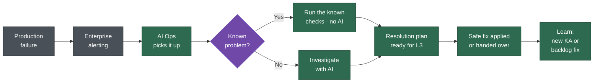
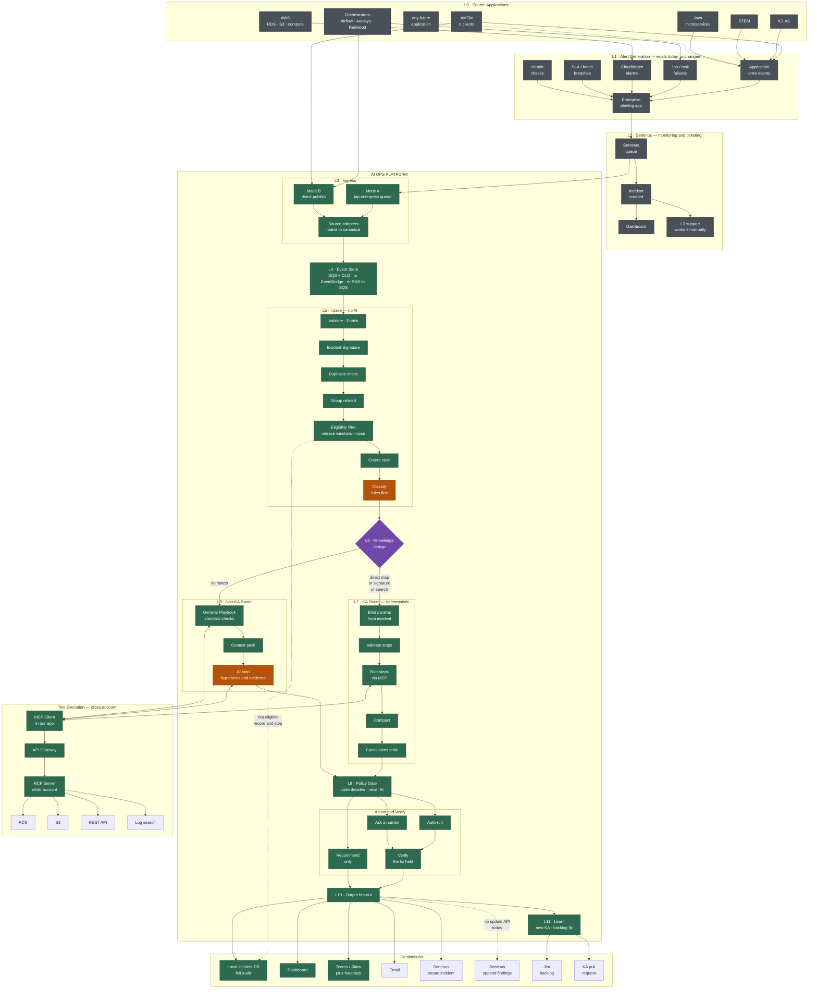
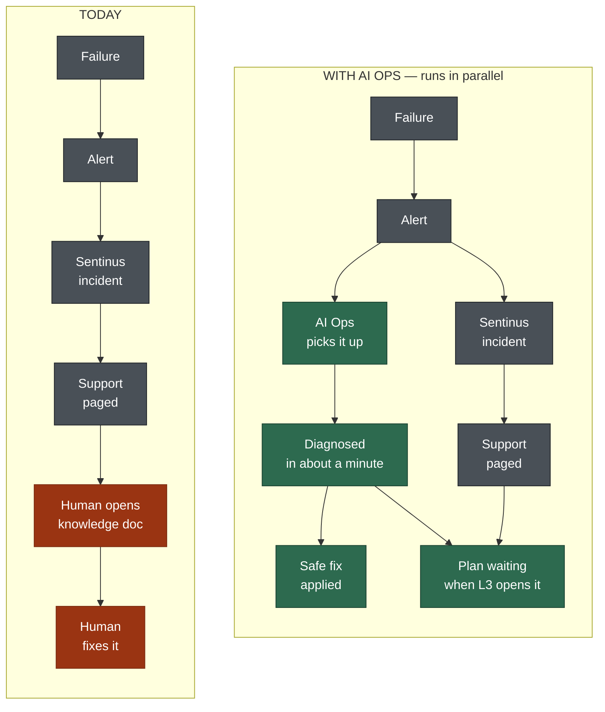
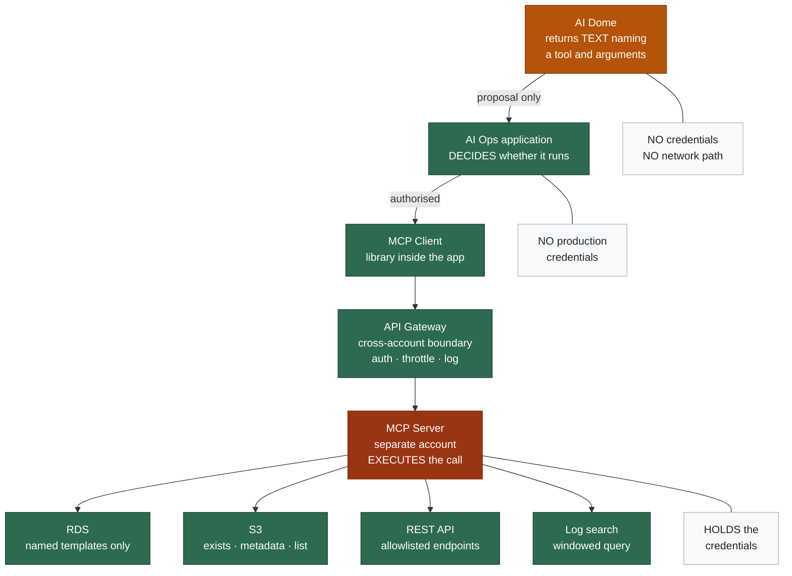
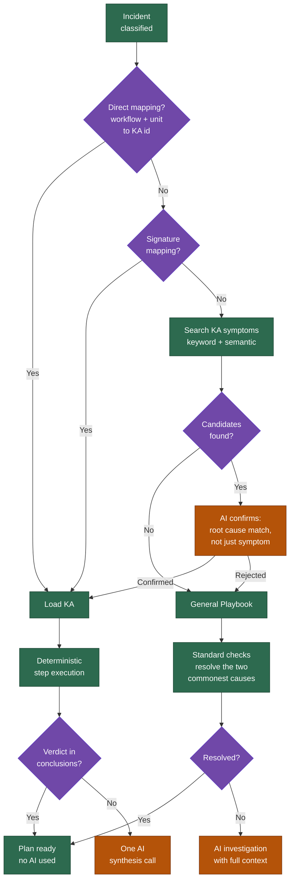
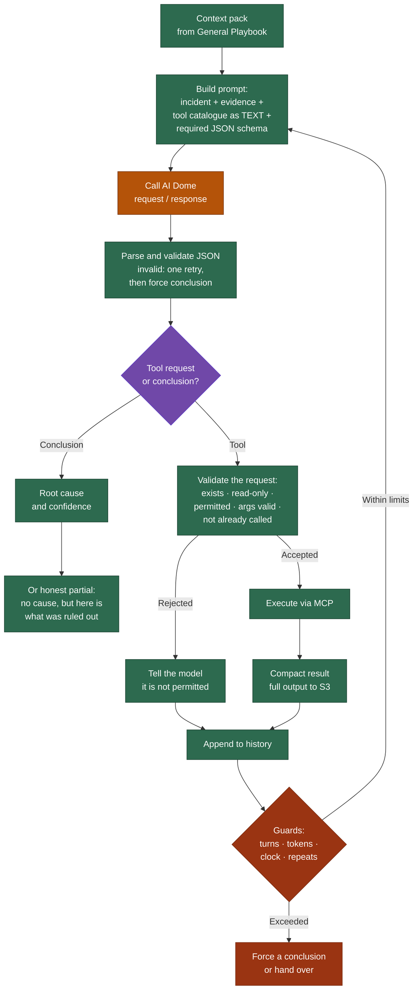
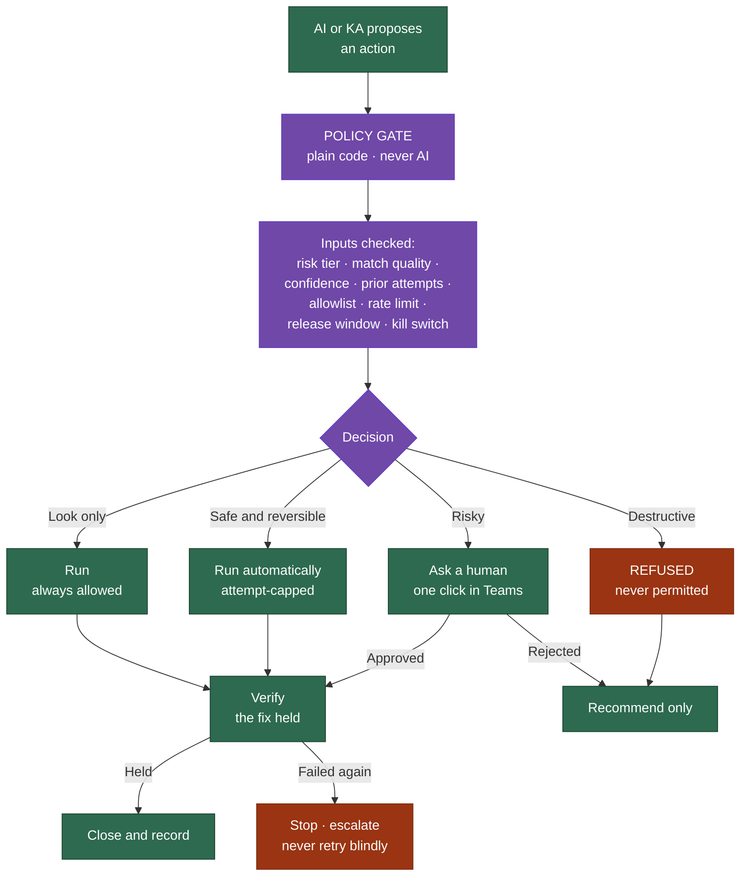
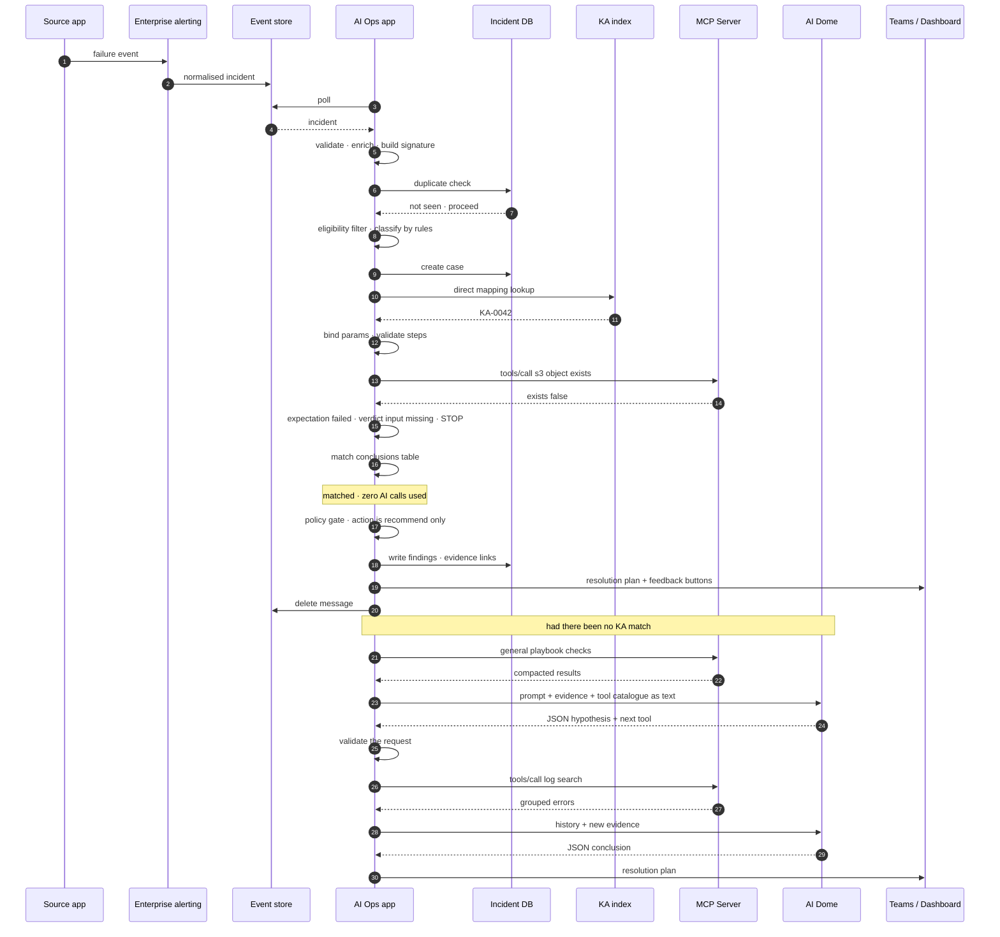
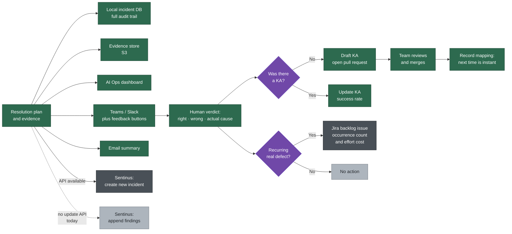

# AI Ops — Logical Flow

| Field | Value |
|---|---|
| Version | 1.0 (for review) |
| Date | 2026-09-16 |
| Companion | `ops-assist-design-spec.md` (component-level design) |
| Purpose | End-to-end logical flow for senior leadership, with drill-down depth |

> **How to use this document.** §1–§12 is the flow in words, layer by layer. §13 holds **nine diagram options** as editable Mermaid text — pick the ones that fit your audience, edit the text directly, and they re-render. §14 suggests three slide packs. §15 lists what is still open.

---

## 0. Positioning — what this system is and is not

**AI Ops runs in parallel with the existing support path. It changes nothing upstream.**

| It does | It does not |
|---|---|
| Consume incidents that already exist | Create alerts or page anyone |
| Diagnose and produce a resolution plan | Replace Sentinus or the enterprise alerting layer |
| Execute approved, low-risk fixes | Take irreversible action |
| Have the answer ready when L3 picks up the ticket | Delay or gate the human path |

This framing matters for the leadership conversation: **the system carries no risk to existing operations, because it sits alongside them.** Nothing we build can stop an alert reaching a human.

---

## 1. Layer 0 — Source Applications

Where production errors actually occur. Each has its own stack and its own failure vocabulary.

| # | Source | Failure examples |
|---|---|---|
| L0.1 | **AMTM** | Application exceptions, batch failures, data errors |
| L0.2 | **ICLAS** | Application exceptions, integration failures |
| L0.3 | **STEM** | Application exceptions, processing errors |
| L0.4 | **Java microservices** | Runtime exceptions, health check failures, dependency timeouts |
| L0.5 | **Orchestrators** | Job / task / workflow failures — **Airflow (MWAA)**, **Autosys**, **Redwood**, others |
| L0.6 | **AWS infrastructure** | RDS, S3, compute, networking |
| L0.7 | **`<any future application>`** | Shown as an explicit empty slot |

**Two points to make visible in the diagram:**
1. Each application may have **multiple client instances or tenants** — label them "AMTM (n clients)".
2. **No orchestrator is privileged.** Airflow is first because it is the biggest source of volume, not because the design assumes it. Autosys, Redwood and anything else plug in through the same adapter contract (§4).

---

## 2. Layer 1 — Alert Generation and the Enterprise Path

Every source already emits a signal today. **This layer exists and we do not change it.**

| # | Error category | Path today |
|---|---|---|
| L1.1 | Application error (AMTM / ICLAS / STEM) | Application code publishes to the **EMM / Sentinus queue** |
| L1.2 | Orchestrator job or task failure | Failure signal reaches **Sentinus** |
| L1.3 | CloudWatch alarm | Read by the **enterprise alerting application**, which normalises it and publishes onward |
| L1.4 | Batch / file SLA breach | Schedule monitor raises an alert |
| L1.5 | Service health / synthetic check | Health check raises an alarm |
| L1.6 | **Silent failure** — job reports success, output is wrong | **Not caught today.** A named gap, and a later opportunity |
| L1.7 | Manually raised incident | Human creates the incident in Sentinus |

**Confirmed:** a **separate enterprise application** consumes all of these categories — including CloudWatch alarms — and publishes them onto the monitoring queue. There is no manual hop. Show this as one clean component; do not imply human effort where there is none.

---

## 3. Layer 2 — Enterprise Monitoring and Ticketing (Sentinus)

| # | Step |
|---|---|
| L2.1 | Alerts from every L1 category arrive on the **Sentinus queue** |
| L2.2 | Sentinus ingests, correlates, and creates an **incident / ticket** |
| L2.3 | The incident surfaces on the **application dashboard** |
| L2.4 | The alert routes to the **support team** |
| L2.5 | **L3 support picks up the incident**, opens the knowledge document, and works it manually |

**L2.5 is the cost.** Everything in this design targets L2.5 — not L2.1 to L2.4, which continue untouched.

### 3.1 Sentinus access — confirmed position

| Capability | Status | How to show it |
|---|---|---|
| **Read** incidents from Sentinus | **Not available** | Dotted line, labelled *future* |
| **Create** a new incident via API | **Available** | Solid line — usable today |
| **Update / append** to an existing incident | **Not available** | Dotted line, labelled *future* |

The consequence: **AI Ops cannot write its findings onto the existing ticket yet.** Phase 1 delivers findings through our own channels (§11), and the create-incident API covers the one case where we detect something Sentinus did not — such as a silent failure. Both dotted paths stay on the diagram so they can be enabled later without redesign.

---

## 4. Layer 3 — Ingress into AI Ops

### 4.1 Two ingress modes

| Mode | How | When |
|---|---|---|
| **3.A — Tap the enterprise path** | Subscribe to the existing monitoring queue / topic | **Phase 1.** Zero change for any application team, zero disruption |
| **3.B — Direct publish** | Sources also publish straight into our event store | **Target state.** Lower latency, richer payload, we own the schema |

Show both. 3.A is what makes Phase 1 a no-risk ask; 3.B is where the latency benefit comes from later.

### 4.2 Source Adapters — the extensibility point

| # | Rule |
|---|---|
| L3.C.1 | Every source has an **adapter** that converts its native event into our canonical **`incident.v1`** |
| L3.C.2 | Adapters are **thin field mapping only** — no diagnosis, no AI, no business logic |
| L3.C.3 | An adapter may be deployed **at the source** (inside the application or orchestrator callback) **or centrally** (one Lambda normalising the enterprise queue). Both are supported |
| L3.C.4 | **A new application team writes one adapter and changes nothing in our platform** |
| L3.C.5 | The adapter contract ships as a published schema plus a self-test harness |

**Recommendation:** central adapters for onboarding (nobody has to do any work), at-source adapters for teams that want the richer payload and lower latency. Show both on the diagram.

### 4.3 The canonical incident — what an adapter must produce

Grouped deliberately, because these three things fail independently.

| Block | Fields | Read by |
|---|---|---|
| **Identity** | incident id, tenant / application, source, occurred at, environment | Everything |
| **Orchestrator** | type (`airflow` / `autosys` / `redwood` / `none`), instance, plus a native passthrough block | The orchestrator adapter only |
| **Workflow** *(canonical)* | workflow id, unit id, run id, attempt, business date | KA matching, KA steps, AI prompts |
| **Target** | which system the work touched — RDS instance, S3 bucket, API endpoint, log group | Diagnostic steps |
| **Error** | raw error text, exception type, stack excerpt | Matching and diagnosis |
| **Links** | Sentinus incident id, log URL | Output and correlation |

**Why the canonical vocabulary matters:** Airflow says DAG and task, Autosys says job and box, Redwood says process chain. The platform speaks **workflow** and **unit**, and each adapter translates. A knowledge article written once works across all three.

---

## 5. Layer 4 — Event Store

Options stay open. The contract above it is identical regardless of choice.

| # | Option | Assessment |
|---|---|---|
| L4.1 | **SQS + DLQ** | **Recommended.** Already the enterprise standard pattern, so no new approval needed. Native retry, dead-letter, visibility timeout |
| L4.2 | **EventBridge** | Worth considering if we want content-based routing to different consumers, or multiple independent subscribers |
| L4.3 | **SNS → SQS** | SNS is a broadcast topic; subscribing several SQS queues to it lets a second consumer — say a metrics sink or another team — receive the same events without touching producers. Only needed if multiple consumers become a requirement |

**Stated plainly for the diagram:** one box labelled *Event Store*, with the options listed inside and SQS + DLQ marked as the starting choice. The point to make is that **this decision is reversible and does not affect anything downstream.**

---

## 6. Layer 5 — Intake Processing

Everything here is **deterministic code — no AI.** This is the cheapest and most reliable part of the system, and it runs before any decision about what to do.

| # | Step | What it does |
|---|---|---|
| L5.1 | **Consume** | Long-poll the event store |
| L5.2 | **Validate** | Schema check. Malformed → dead-letter queue and an alarm. Never guess at a broken payload |
| L5.3 | **Enrich** | Resolve owning application, tenant, environment, support group from configuration |
| L5.4 | **Build the Incident Signature** | Normalise the error text — strip timestamps, IDs, numbers, paths — then combine it with the workflow and unit name. Two occurrences of the same failure produce the same signature |
| L5.5 | **Duplicate check** | Signature already in flight or recently closed → link to the existing case and stop |
| L5.6 | **Group related incidents** | Many incidents in a short window sharing a cause → one **parent case**, children linked. This is what stops one late upstream feed becoming forty separate investigations |
| L5.7 | **Eligibility filter** | Is this in scope? Checks: application onboarded · environment is production · source enabled · **not inside a release or blocker window** · not a known-noise pattern |
| L5.8 | **Not eligible** | Record it, count it, stop. No output, no noise. Confirmed as a real case — release-window failures are already suppressed today by the same logic |
| L5.9 | **Create the case** | Write the case record to our local incident database. Status `RECEIVED` |
| L5.10 | **Classify** | Assign category and priority. **Rules first** — pattern match on error type and workflow; AI only for what rules cannot classify. Runs for **every** incident, before the knowledge lookup |
| L5.11 | **Prioritise the queue** | High-priority incidents are processed **first**, so the resolution plan is ready sooner. AI Ops **never pages, alerts or notifies anyone** — that is the enterprise path's job, and it is already happening in parallel |

### 6.1 Terminology note

**"Incident Signature"** replaces the earlier term *fingerprint* throughout. Same mechanism, plainer word: it is the normalised shape of an error, used to recognise a repeat.

---

## 7. Layer 6 — Knowledge Lookup and Routing

Two lookup mechanisms, both supported, in this order.

| # | Mechanism | How | Trust |
|---|---|---|---|
| L6.1 | **Direct mapping** | An authored table: `workflow + unit → KA id`. For example a specific Airflow DAG and task maps to exactly one KA. Deterministic, instant, no search, no ambiguity | **Highest** |
| L6.2 | **Signature mapping** | A learned table: Incident Signature → KA id, populated when a case is resolved. Catches repeats the authored table missed | High |
| L6.3 | **Search** | Hybrid keyword and semantic search over KA symptom text, filtered by application and workflow. Returns candidates, not answers | Candidate only |
| L6.4 | **Confirm** | One AI Dome call: *do any of these candidate KAs match the root cause, not just the symptom?* Returns strict JSON | Verified candidate |
| L6.5 | **Parse and validate** | Our code validates the JSON. Invalid → one retry with the schema → then treat as no match | — |

**Why both mechanisms.** Direct mapping is the right answer for the failures you already understand — one DAG, one known failure, one KA, no guessing. Search covers everything else, and generalises to applications that have not built a mapping table yet. **Start with direct mapping for your top failures; search is the safety net.**

**The routing decision:**

- **KA found** → §8, the deterministic route
- **No KA** → §9, the general playbook, then AI investigation

### 7.1 Where knowledge lives

Knowledge articles are **Markdown files in Git**, owned by the application teams, deployed to S3 on merge and indexed for search. Each file has two parts: structured steps that the platform executes, and prose that a human reads.

**The one-line version for leadership:** *the knowledge document becomes executable, and the teams who own the system own the knowledge.*

---

## 8. Layer 7 — KA Route (deterministic)

### 8.1 Load and prepare

| # | Step |
|---|---|
| L7.1 | Load the KA — its steps and its conclusions table |
| L7.2 | **Bind parameters from the incident.** Resolve every placeholder in the KA against the incident: workflow id, unit id, run id, attempt, business date, target identifiers, environment, error text, plus tenant configuration values |
| L7.3 | **Validate every step** against the live tool registry — the tool exists, arguments match its schema, the tool is read-only, this application is permitted to use it |
| L7.4 | Any step invalid → **do not run a half-broken KA.** Fall through to the AI route and flag the KA for review |

### 8.2 The MCP call chain

The MCP Server runs in a **different account** from the application resources. The chain, with the credential boundary marked:

| # | Layer | Responsibility | Holds credentials? |
|---|---|---|---|
| L7.5 | **AI Ops application** | Decides *whether* a call happens | No production credentials |
| L7.6 | **MCP Client** | A library **inside** the application — not a service. Holds the cached tool catalogue, formats the call, handles retry and timeout | No |
| L7.7 | **Cross-account boundary** | API Gateway or PrivateLink. Authentication, authorisation, throttling, request logging | — |
| L7.8 | **MCP Server** | Runs in its own account. **Executes** the call. Assumes a cross-account role into the application account to reach the actual resources | **Yes** |
| L7.9 | **Targets** | **RDS** — named query templates only, never free-form SQL · **S3** — object exists, metadata, list, sample · **REST API** — allowlisted endpoints · **Log search** — windowed query on a log group | — |

**Two facts worth stating explicitly on the slide, because they get asked every time:**

1. **The AI executes nothing.** AI Dome returns text naming a tool and its arguments. Our application decides whether that runs. The MCP Server performs the actual call. Three layers, three separate responsibilities.
2. **The AI Ops application holds no production credentials at all.** Even a defect in our own orchestration logic cannot reach RDS or S3 directly.

*Open item: whether a separate enterprise MCP Gateway sits between the API Gateway and the MCP Server is unconfirmed. Drawn as one boundary; splits into two if the gateway exists (§15).*

### 8.3 Step execution — deterministic loop, no AI

| # | Step |
|---|---|
| L7.10 | For each step in order: evaluate its condition, skip if not applicable |
| L7.11 | Call the tool through the MCP chain |
| L7.12 | **Compact the result.** Full output → evidence store in S3. A short summary stays in the case. A log search returning 50,000 lines becomes roughly 15 grouped error patterns |
| L7.13 | **Capture named outputs** for later steps — for example, take a job run identifier out of a log line and use it in the next call |
| L7.14 | **Evaluate the expectation.** The KA author wrote down what "good" looks like: a field, a comparison, a value. The runner compares and gets pass or fail |
| L7.15 | On fail, record the named **verdict** and either stop or skip ahead, as the KA specifies |
| L7.16 | Continue until steps are exhausted, a step says stop, or the step or time budget is reached |

**How the program knows when to stop without AI:** the KA author already knew what conclusive looks like and wrote it down as a comparison. If the expected file is absent, that *is* the diagnosis — no further steps are needed, and no intelligence is required to recognise it.

### 8.4 Conclusion

| # | Step | AI call? |
|---|---|---|
| L7.17 | Match collected verdicts against the KA's **conclusions table**. First match wins | No |
| L7.18 | **Matched** → root cause, severity, recommended action, and a pre-written summary for support | **Zero** |
| L7.19 | **No match** → one **synthesis** call to AI Dome with the KA text and the compacted evidence, returning strict JSON, which our code parses and validates | One |

**The number for the leadership slide:** the most common failures produce a complete, correct resolution plan **in seconds, with no AI cost at all.** AI is the exception path, not the default.

---

## 9. Layer 8 — Non-KA Route

### 9.1 The General Playbook runs first

A knowledge article in every respect — same format, same validation, same execution engine — but selected by fallback rather than by match.

| # | Step |
|---|---|
| L8.1 | Load the **General Playbook** |
| L8.2 | **Standard orchestrator checks**, through whichever adapter applies: unit state · duration against normal · attempt number · last successful run · recent run history · upstream dependency state · sibling units in the same run · what else is failing right now |
| L8.3 | **Standard target checks**, by target type: database reachable and healthy · expected S3 object present · API endpoint responding |
| L8.4 | **Log scan** for the failure window through MCP log search |
| L8.5 | Its own conclusions table resolves the two most frequent causes **with no AI call at all**: *an upstream dependency failed first*, and *this is a platform-wide event affecting many unrelated workflows* |
| L8.6 | No match → continue to the AI loop, **carrying a full context pack** |

**This is the highest-value item in the non-KA path.** Two of the most common causes never reach AI, and when AI is reached it starts from comparative context — *it ran fine for 90 days, twelve other workflows failed in the same ten minutes* — rather than a bare error string. Comparative context, not cleverer prompting, is what drives diagnosis quality.

### 9.2 AI investigation loop

**AI Dome is request/response with no tool-calling parameter.** The loop is therefore built in our application: we render the tool catalogue as text in the prompt, require strict JSON back, and parse it ourselves.

| # | Step | Where |
|---|---|---|
| L8.7 | Build the prompt: incident + context pack + compacted evidence + **tool catalogue as text** + the required JSON schema | Our app |
| L8.8 | **Call AI Dome** | AI Dome |
| L8.9 | **Parse and validate the JSON.** Invalid → one retry with the schema → then force a conclusion | Our app |
| L8.10 | The response is either *a hypothesis plus the next tool to run plus what it expects to find*, or *a conclusion* | — |
| L8.11 | If a tool is requested, **validate it**: does it exist, is it read-only, is it permitted for this application, are the arguments schema-valid, has it already been called with these arguments? | Our app |
| L8.12 | Execute through the MCP chain → compact → append to evidence | MCP Server |
| L8.13 | Append to the history and **loop back to L8.8.** AI Dome is stateless, so the full history and catalogue are resent every turn | Our app |
| L8.14 | **Guards:** maximum around six turns · token budget per incident · wall-clock limit · no repeated identical calls · escalate rather than loop | Our app |
| L8.15 | Conclude — **or return an honest partial result:** no root cause, but here is what was ruled out and where the problem has been narrowed to | — |

**Why the hypothesis format.** The model must state what it expects to find *before* the tool runs. That makes the reasoning auditable, and lets us measure whether its predictions actually hold.

**Why "I don't know" is a valid output.** A confidently wrong diagnosis is worse than an honest partial one. Four possibilities ruled out and a narrowed search area is still real time saved for L3.

### 9.3 Agents — the honest design

The one-page summary names seven agents. That framing is good and worth keeping in the narrative. The right *implementation* is **stages inside one application**, not seven services.

| Stage | Where it lives in this flow | Real AI? |
|---|---|---|
| **Detect** | Layers 1 and 3 — adapters and ingress | No |
| **Triage** | L5.10 classify | Rules first, AI fallback |
| **Knowledge** | §7 lookup | Only the confirm step |
| **Diagnosis** | §8 step runner and §9 investigation | KA route no, non-KA route yes |
| **Fix** | §10 policy gate and executor | **No — deterministic rules only, deliberately** |
| **Verify** | L9.4 | No |
| **Learning** | §12 | Yes, for drafting |
| **Supervisor** | The orchestrator loop itself | No |

**Why one application and not seven services:** the stages share one case file, run in a fixed sequence, and have no independent scaling need. Seven services would multiply deployment, monitoring and failure modes for no benefit. **Split a stage out only when a different team needs to own it, or when it needs different permissions** — which is exactly why the executor and the MCP action path *are* separate.

**Only three stages involve AI at all.** Worth saying out loud, because "a team of AI agents" can otherwise sound like AI is making every decision.

---

## 10. Layer 9 — Decision, Action, Verify

**This sequence always runs and cannot be reordered, skipped or configured away.**

| # | Step | AI? |
|---|---|---|
| L9.1 | **Policy Gate.** Plain code decides whether a proposed action may run. Inputs: the action's risk tier, how the KA was matched, AI confidence, prior attempts on this incident, the application's allowlist, rate limits, release and change-freeze windows, and the kill switch | **Never** |
| L9.2 | Three outcomes: **run automatically** (low risk, high trust) · **ask a human** (one click to approve) · **recommend only** (present the plan, take no action) | No |
| L9.3 | **Execute** through the MCP **action** path — a separate server with separate credentials, so the read and write paths are physically distinct | No |
| L9.4 | **Verify** — confirm the fix actually worked. Failure after an automatic action → **stop and escalate, never retry blindly** | No |
| L9.5 | **Approval branch** — save the case, post to Teams or Slack with approve and reject buttons, release the queue message. A callback resumes execution. Approver group checked, request expires | No |

### 10.1 Action levels

| Level | Examples | Mode |
|---|---|---|
| **Look only** | Read logs, check a file, query status | Always automatic |
| **Safe and reversible** | Re-run a failed unit, retry a transient error | Automatic once proven, attempt-capped |
| **Risky** | Restart a service, backfill, resize | One-click human approval |
| **Destructive** | Delete data, change permissions, alter schema | **Never permitted** |

**The single most important line in the whole design:** the AI can only ever *propose*. Every execution is authorised by deterministic code that we wrote and can unit-test. This is also why a malicious or malformed log line is harmless — it might persuade the model to suggest something, and the gate will refuse it.

---

## 11. Layer 10 — Output

| # | Destination | Contents | Status |
|---|---|---|---|
| L10.1 | **Local incident database** | Full case record: timeline, every AI prompt and response, every tool call, gate decision, action, outcome. Complete audit trail | **Ours — always available** |
| L10.2 | **Evidence store (S3)** | Full uncompacted tool output, linked from the case | **Ours** |
| L10.3 | **AI Ops dashboard** | Live cases, resolution plans, metrics, **feedback buttons** | **Ours** |
| L10.4 | **Teams / Slack** | Diagnosis summary, approval requests, **right / wrong feedback with actual cause** | Low friction, high confidence |
| L10.5 | **Email** | Summary to the support distribution list | Available |
| L10.6 | **Sentinus — create incident** | For something we detected that Sentinus did not, such as a silent failure | **API available** |
| L10.7 | **Sentinus — append findings to the existing incident** | The resolution plan as a work note | **Dotted — no update API today** |
| L10.8 | **Jira backlog issue** | The *permanent engineering fix*, recurrence-gated and deduplicated | Needs access |
| L10.9 | **KA pull request** | An AI-drafted knowledge article into the owning team's repository | Needs repository access |

**Phase 1 recommendation:** L10.1, L10.3 and L10.4 only. Tickets untouched, no production risk, and the feedback buttons generate exactly the accuracy baseline needed to decide on Phase 2.

**Why the feedback button is not optional:** without it there is no accuracy metric, no source of new knowledge articles, and no evidence to justify turning on autonomy.

---

## 12. Layer 11 — Learn

| # | Step |
|---|---|
| L11.1 | Capture the human verdict on each diagnosis: right, or wrong with the actual cause |
| L11.2 | Resolved with no KA → AI drafts a knowledge article → **opens a pull request** on the owning team's repository → CI validates the steps → the team reviews and merges |
| L11.3 | On merge: deploy, index, and **record the signature mapping**, so the next identical failure is an instant direct match |
| L11.4 | A recurring root cause that is a real defect → **Jira backlog issue** carrying occurrence count and accumulated effort cost. Recurrences update it rather than creating duplicates |
| L11.5 | Track success rate per knowledge article. One whose fix keeps failing is flagged for review automatically |
| L11.6 | Track **recurring failures with no open backlog issue** — the silently-absorbed-effort gap |

**Why L11.4 matters more than it looks.** A system that only produces knowledge articles industrialises the repetitive work instead of removing it. The backlog issue is how the underlying defect stays visible after the pain has been automated away.

**The leadership line:** the unknown path shrinks by construction. Every hard incident either becomes a cheap one, or stops happening.

---

## 13. Diagram Options

All diagrams are **Mermaid** — plain text that renders as a diagram. Edit the text and it re-renders. Works in GitHub, VS Code, Confluence with the Mermaid macro, mermaid.live, and most modern documentation tools. From mermaid.live you can export SVG or PNG for slides.

Nine options below. **§14 suggests which to use together.**

---

### D1 — Executive one-liner
*One slide, understood in fifteen seconds. Use as the opening visual.*

---

### D2 — Full layered end-to-end
*The main diagram. Everything, in layers, with the platform boundary visible.*

---

### D3 — Current state vs target state
*Use when the message is "we change nothing upstream". Strongest diagram for a risk-focused audience.*

---

### D4 — Inset: the MCP call chain
*Answers "how does it actually reach our systems, and who holds the credentials".*

---

### D5 — Inset: routing decision
*The KA vs no-KA branch, with both lookup mechanisms.*

---

### D6 — Inset: the AI investigation loop
*Shows the cycle and, crucially, the guards on the exit.*

---

### D7 — Inset: the decision gate
*The safety slide. Use whenever autonomy is questioned.*

---

### D8 — Sequence: line-by-line call trace
*For the engineering audience, or when your principal asks exactly what calls what. A single incident, end to end.*

---

### D9 — Output fan-out and the learning loop
*Shows what is available today versus what needs access, and how the loop closes.*

---

## 14. Suggested slide packs

**Pack A — Leadership, 15 minutes**
1. **D1** — the one-liner
2. **D3** — current vs target, the "we change nothing" message
3. **D7** — the safety gate
4. Phasing and measures of success from the concept brief

**Pack B — Leadership with a technical principal in the room**
1. **D1** — the one-liner
2. **D2** — the full layered flow
3. **D4** — the MCP chain and the credential boundary
4. **D6** — the AI loop and its guards
5. **D7** — the safety gate
6. **D9** — the learning loop

**Pack C — Engineering design review**
1. **D2** — the full layered flow
2. **D5** — routing decision
3. **D8** — the sequence trace
4. **D4** — MCP chain
5. The companion component specification

**Editing tips.** Paste any block into mermaid.live to edit visually and export SVG or PNG. The `classDef` lines at the bottom of each diagram control colours — change them once to match your deck's palette. To simplify a diagram for a slide, delete nodes and their arrows; nothing else needs adjusting.

---

## 15. Open items

| # | Item | Why it matters | Owner |
|---|---|---|---|
| O1 | Is there a separate enterprise **MCP Gateway** between the API Gateway and the MCP Server? | One boundary hop or two in D2 and D4 | |
| O2 | Which **orchestrators** are in scope, and in what order after Airflow? | Adapter build order | |
| O3 | **Database targets** — Postgres, Oracle, DynamoDB, or a mix? | Which query-template tooling to build | |
| O4 | **Sentinus update API** — is it genuinely unavailable, or unapproved? | Turns L10.7 from dotted to solid | |
| O5 | **AI Dome** — confirm the request and response format, context limit, and rate limits | Sizing the investigation loop | |
| O6 | **Jira** access and target project | Enables the permanent-fix loop | |
| O7 | **KA repository** — one central repo with per-team folders, or one per team? | Ownership and validation model | |
| O8 | **Cost ceiling** per incident and per month | Budget guards and kill-switch thresholds | |
| O9 | Who **triages** AI-raised backlog issues? | Without an owner they accumulate unread | |

---

## 16. Changes from the earlier design

| # | Change | Reason |
|---|---|---|
| Δ1 | **AI Dome has no tool-calling parameter** | The investigation loop is built in our application: tool catalogue rendered as text, strict JSON required back, parsed and validated by our code |
| Δ2 | **MCP Server is cross-account**, reaching resources in the application account | Adds the API Gateway boundary and a cross-account role to the chain |
| Δ3 | **Target systems narrowed** to RDS, S3, REST API and log search | Earlier drafts assumed AWS Glue, ECS and EMR specifics. Removed |
| Δ4 | **Sentinus: create-only** | No read access, no update API. Findings go to our own channels in Phase 1 |
| Δ5 | **Enterprise queue is the primary ingress** for Phase 1 | Zero disruption; direct publish becomes the target state |
| Δ6 | **Classification moved before knowledge lookup** | Priority is needed for queue ordering regardless of whether a KA exists |
| Δ7 | **AI Ops never pages, alerts or notifies** | It is a parallel assist system. The enterprise path already handles escalation |
| Δ8 | **"Fingerprint" renamed "Incident Signature"** | Plainer language for a mixed audience |
| Δ9 | **Direct workflow-to-KA mapping is a first-class lookup**, ahead of search | Deterministic and unambiguous for known failures |
| Δ10 | **Kinesis removed** from event store options | Not permitted in the enterprise |
| Δ11 | **Seven agents are logical stages in one application**, not seven services | Shared case file, fixed sequence, no independent scaling need. Executor stays separate for credential isolation |
